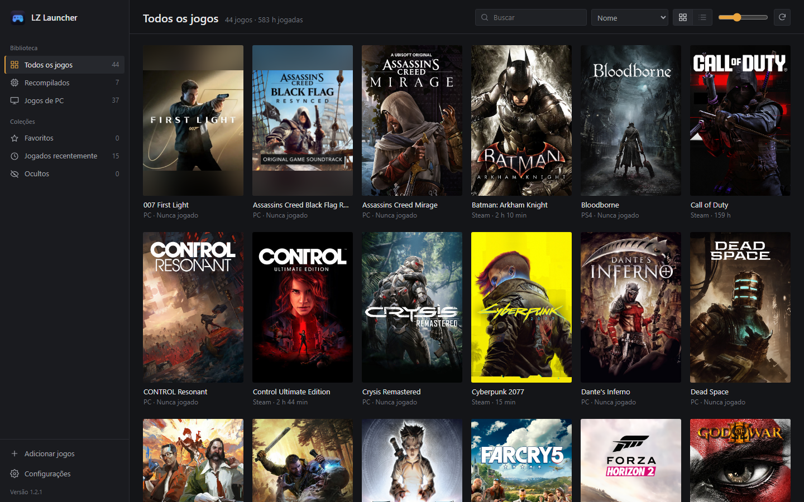
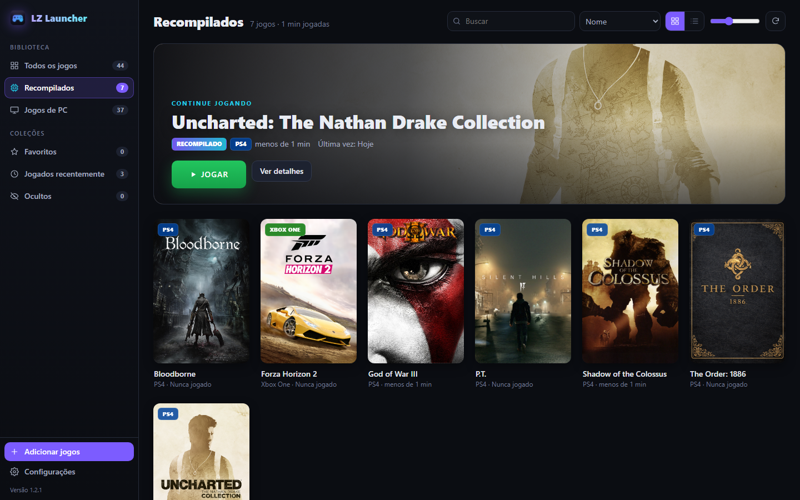
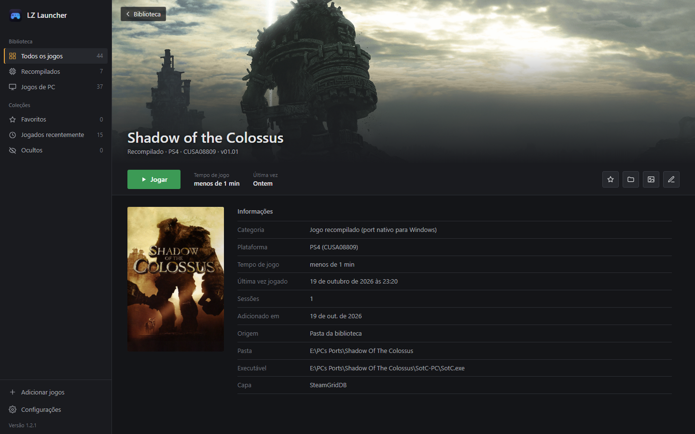
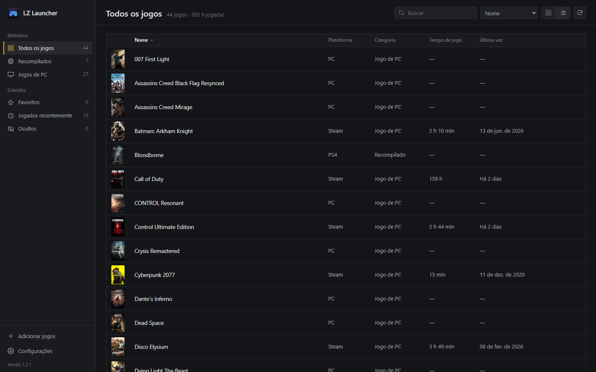
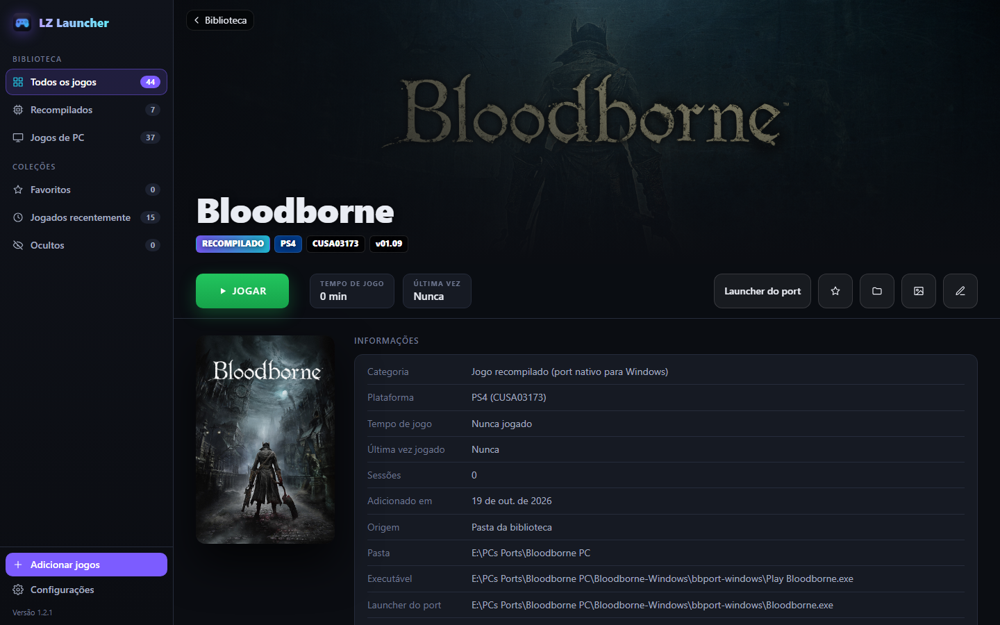

# LZ Launcher

**Criado por Lagaz** · Windows 10/11 64-bit

Biblioteca e launcher que junta num lugar só os seus **jogos recompilados** (ports nativos de jogos de **PS4, PS3, Xbox** e outros consoles rodando direto no Windows) e os seus **jogos de PC**. Ele reconhece cada jogo sozinho, mostra a **capa correta**, conta o **tempo de jogo** e abre tudo com um clique.

## Download

Na página de [**Releases**](../../releases/latest):

| Arquivo | Para quem |
|---|---|
| `LZ-Launcher-Setup-x.y.z.exe` | Instala o programa (sem pedir administrador), cria atalhos no Menu Iniciar/Área de Trabalho e aparece em *Configurações → Aplicativos*, com desinstalador. |
| `LZ-Launcher-Portable-x.y.z.zip` | Não instala nada: extraia em qualquer pasta ou pendrive e abra `LZ Launcher.exe`. Biblioteca e configurações ficam na pasta `data` ao lado do exe. |

> O Windows SmartScreen pode avisar "O Windows protegeu o computador", porque os executáveis não têm assinatura digital paga. Clique em **Mais informações → Executar assim mesmo**.

## Atualizações automáticas

O app verifica as [Releases](../../releases) deste repositório ao abrir e a cada 6 horas. Quando sai uma versão nova, aparece um aviso (na tela e na bandeja do Windows) e um cartão na barra lateral com o botão **Atualizar agora**. O app então:

1. baixa o arquivo certo: o Setup, se estiver instalado, ou o Portable;
2. fecha, aplica a atualização e reabre sozinho;
3. mantém sua biblioteca, capas e tempo de jogo.

Também dá para procurar na hora em **Configurações → Atualizações → Procurar atualizações**, ou por script: `"LZ Launcher.exe" --update`.

## O que ele faz

### Recompilados e jogos de PC separados

- Barra lateral com **Recompilados**, **Jogos de PC** e **Todos os jogos**, mais as coleções **Favoritos**, **Jogados recentemente** e **Ocultos**.
- **Adicionar pasta de jogos**: escolha uma pasta com vários jogos (cada subpasta vira um jogo) ou a pasta de um jogo só. Dá para dizer se ela é de Recompilados, Jogos de PC ou deixar no automático.
- Reconhece ports recompilados por:

| O que tem na pasta | O que o app entende |
|---|---|
| `CUSAxxxxx/sce_sys/param.sfo` | Dump de **PS4** — nome, Title ID, versão, ícone e imagem de fundo oficiais |
| `PS3_GAME/PARAM.SFO` | Dump de **PS3** |
| `AppxManifest.xml` (Xbox) | Dump de **Xbox One** |
| `Play <Jogo>.exe` + `<Jogo>.exe` | Port com launcher: **Jogar** abre direto no jogo e **Launcher do port** abre as configurações do port |
| `out/analysis.json`, `eboot.bin`, *PC Port*, *recomp* | Outros ports recompilados |

- Jogos instalados pela **Steam** e pela **Epic Games** aparecem sozinhos (com o tempo de jogo registrado na Steam).
- Ignora executáveis auxiliares (instaladores, crash reporters, ferramentas) e escolhe o executável certo de cada jogo. Dá para trocar em **Editar**.

### Página de cada jogo

- **Jogar**, **tempo de jogo**, **última vez jogado** e **sessões**.
- O tempo é contado enquanto qualquer processo da pasta do jogo estiver aberto — funciona com ports que abrem outro processo e até quando o jogo é aberto fora do launcher.
- **Capas e imagens de fundo automáticas**: arte do próprio jogo, loja Steam, Wikipédia (capa da caixa) e [SteamGridDB](https://www.steamgriddb.com) (chave opcional, grátis). Dá para trocar por outra opção ou por qualquer imagem do PC.
- Favoritar, ocultar, renomear, mudar a categoria, escolher o executável e passar argumentos de inicialização.

### Grade ou lista

Alterne entre **grade** de capas (com tamanho ajustável) e **lista** com plataforma, categoria, tempo de jogo e última vez — clique no cabeçalho para ordenar.

### Temas

Dois temas em **Configurações → Aparência**: **Sóbrio** (cinzas neutros) e **Neon** (roxo e ciano, com o destaque *Continue jogando*).

### Bandeja do sistema
Fechar a janela **minimiza o LZ Launcher para a bandeja**, perto do relógio — ele continua contando o tempo de jogo. Clique duas vezes no ícone para voltar ou em **Sair** para fechar de vez. Dá para desligar nas configurações.

## Aviso

O LZ Launcher **não inclui jogos** nem arquivos de jogos: ele só organiza e abre o que já está no seu PC. Os ports recompilados precisam dos seus próprios dumps, conforme as instruções de cada port. O app **nunca altera** nada dentro das pastas dos jogos. Projeto da comunidade, sem relação com Sony, Microsoft, Valve ou Epic Games.

## Créditos

- [pywebview](https://github.com/r0x0r/pywebview) — janela do app (WebView2)
- [psutil](https://github.com/giampaolo/psutil) — contagem do tempo de jogo
- [pystray](https://github.com/moses-palmer/pystray) — ícone na bandeja
- [Pillow](https://github.com/python-pillow/Pillow) e [icoextract](https://github.com/jlu5/icoextract) — imagens e ícones dos jogos
- Capas: loja Steam, [Wikipédia](https://www.wikipedia.org) e [SteamGridDB](https://www.steamgriddb.com)
- [PyInstaller](https://pyinstaller.org) e [Inno Setup](https://jrsoftware.org/isinfo.php) — executável e instalador

## Licença

[MIT](LICENSE) © Lagaz
