

# LZ Launcher

**Criado por Lagaz** · Windows 10/11 64-bit · Português · English · Español

Biblioteca e launcher que junta num lugar só os seus **jogos recompilados** (ports nativos de jogos de **PS4, PS3, Xbox** e outros consoles rodando direto no Windows) e os seus **jogos de PC** de todas as lojas. Ele reconhece cada jogo sozinho, mostra a **capa correta** e as **informações do jogo**, conta o **tempo de jogo**, mostra as **conquistas e troféus** de cada jogo e abre tudo com um clique — ou com o **controle**, no **Modo TV**, direto do sofá.

## Download

Na página de [**Releases**](../../releases/latest):

| Arquivo | Para quem |
|---|---|
| `LZ-Launcher-Setup-x.y.z.exe` | Instala o programa (sem pedir administrador), cria atalhos no Menu Iniciar/Área de Trabalho e aparece em *Configurações → Aplicativos*, com desinstalador. |
| `LZ-Launcher-Portable-x.y.z.zip` | Não instala nada: extraia em qualquer pasta ou pendrive e abra `LZ Launcher.exe`. Biblioteca e configurações ficam na pasta `data` ao lado do exe. |

> O Windows SmartScreen pode avisar "O Windows protegeu o computador", porque os executáveis não têm assinatura digital paga. Clique em **Mais informações → Executar assim mesmo**.

## Atualizações automáticas

O app verifica as [Releases](../../releases) deste repositório ao abrir e a cada 6 horas. Quando sai uma versão nova, aparece um aviso (na tela e na bandeja do Windows) e um cartão na barra lateral com o botão **Atualizar agora**. O app então:

1. baixa o arquivo certo: o Setup, se estiver instalado, ou o Portable;
2. fecha, aplica a atualização e reabre sozinho;
3. mantém sua biblioteca, capas, tempo de jogo e histórico.

Também dá para procurar na hora em **Configurações → Atualizações → Procurar atualizações**, ou por script: `"LZ Launcher.exe" --update`.

## Idiomas

O app está em **português, inglês e espanhol** e escolhe sozinho o idioma do Windows. Dá para trocar em **Configurações → Idioma** — as descrições dos jogos também passam a vir no idioma escolhido.

## O que ele faz

### Recompilados e jogos de PC separados

- Barra lateral com **Recompilados**, **Jogos de PC** e **Todos os jogos**, mais as coleções **Favoritos**, **Jogados recentemente** e **Ocultos**.
- **Adicionar pasta de jogos**: escolha uma pasta com vários jogos (cada subpasta vira um jogo) ou a pasta de um jogo só. Dá para dizer se ela é de Recompilados, Jogos de PC ou deixar no automático.
- Reconhece ports recompilados por:

| O que tem na pasta | O que o app entende |
|---|---|
| `CUSAxxxxx/sce_sys/param.sfo` | Dump de **PS4** — nome, Title ID, versão, ícone e imagem de fundo oficiais |
| `PS3_GAME/PARAM.SFO` | Dump de **PS3** |
| `AppxManifest.xml` (Xbox) | Dump de **Xbox One** |
| `Play <Jogo>.exe` + `<Jogo>.exe` | Port com launcher: **Jogar** abre direto no jogo e **Launcher do port** abre as configurações do port |
| `out/analysis.json`, `eboot.bin`, *PC Port*, *recomp* | Outros ports recompilados |

- Ignora executáveis auxiliares (instaladores, crash reporters, ferramentas) e escolhe o executável certo de cada jogo. Dá para trocar em **Editar**.

### Todas as suas lojas

Os jogos instalados por estas lojas aparecem sozinhos em **Jogos de PC** (cada uma pode ser desligada em **Configurações → Lojas**):

| Loja | Como o jogo abre |
|---|---|
| **Steam** | pela Steam (inclui o tempo de jogo registrado na Steam) |
| **Epic Games** | pela Epic Games Launcher |
| **GOG Galaxy** | direto pelo executável do jogo (com as capas da GOG) |
| **Ubisoft Connect** | pelo Ubisoft Connect |
| **EA app** | pelo executável do jogo |
| **Battle.net** | pelo executável do jogo |
| **Xbox / Game Pass** | pelo app do Xbox (jogos nas pastas `XboxGames`) |

### Página de cada jogo

- **Sobre o jogo**: descrição, gêneros, desenvolvedora, publicadora, ano de lançamento e **nota do Metacritic**, buscados na loja Steam ou na Wikipédia/Wikidata (inclusive para os ports recompilados).
- **Histórico de sessões**: cada vez que você joga fica registrada, com data, horário e duração.
- **Tempo de jogo** e **última vez jogado**. O tempo é contado enquanto qualquer processo da pasta do jogo estiver aberto — funciona com ports que abrem outro processo e até quando o jogo é aberto fora do launcher.
- **Capas e imagens de fundo automáticas**: arte do próprio jogo, loja Steam, GOG, Wikipédia (capa da caixa) e [SteamGridDB](https://www.steamgriddb.com) (chave opcional, grátis). Dá para trocar por outra opção ou por qualquer imagem do PC.
- Favoritar, ocultar, renomear, mudar a categoria, escolher o executável e passar argumentos de inicialização.

### Conquistas e troféus
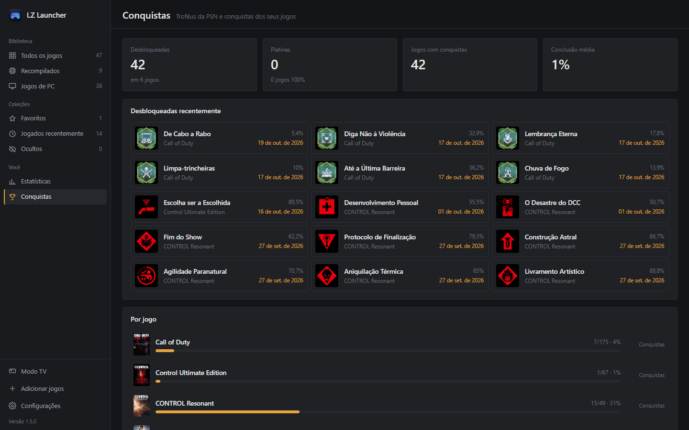

Cada jogo ganha a lista **oficial** de conquistas, sozinho, assim que entra na biblioteca:

- **Ports recompilados de PS4/PS5**: os **troféus da PSN** (platina, ouro, prata e bronze), com os ícones oficiais tirados do próprio jogo e a raridade de cada troféu. Coletâneas, como a de Uncharted, aparecem separadas por jogo.
- **Jogos de PC**: as **conquistas da Steam**, em português quando o jogo tem tradução, com ícones, conquistas secretas e a porcentagem de jogadores que desbloqueou cada uma. Funciona também com jogos que não vieram da Steam: o app descobre o jogo pelo nome.
- **Jogos sem conquistas na Steam** (ports de Xbox, PS3 e outros): a lista da plataforma original.

**Aviso na hora, por cima do jogo**: quando você desbloqueia uma conquista, aparece um aviso no canto da tela com som, sem tirar o foco do jogo (use o modo janela sem bordas). O desbloqueio é lido dos arquivos que o jogo grava no PC: Steam e emuladores como Goldberg/GSE, CODEX, RUNE, OnlineFix e EMPRESS. A página de cada jogo mostra de onde ele está sendo lido.

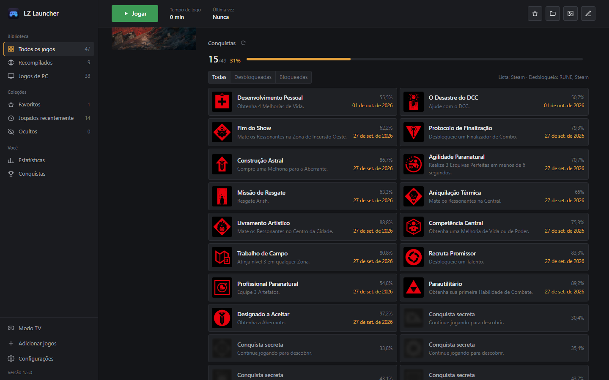

Tem também a página **Conquistas**, com o total desbloqueado, platinas, os desbloqueios recentes e o progresso de cada jogo; o progresso aparece ainda nas capas e no Modo TV.

### Estatísticas
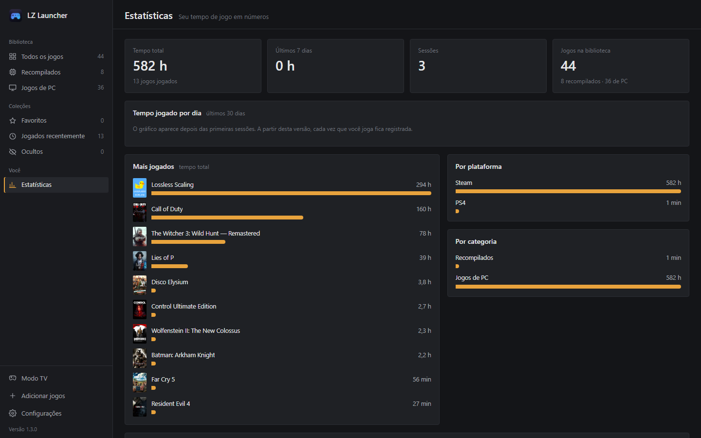

Seu tempo de jogo em números: tempo total, últimos 7 e 30 dias, sessões e duração média, **gráfico de horas jogadas por dia**, **jogos mais jogados**, tempo **por plataforma** e **por categoria**, e as **sessões recentes**.

### Modo TV e controle
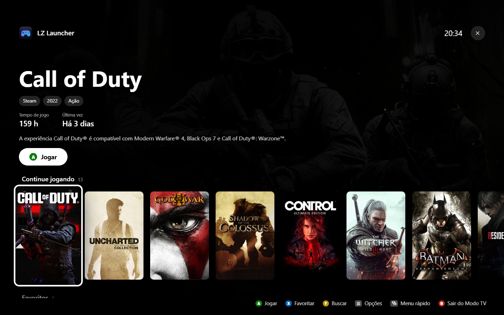

Tela cheia feita para o sofá, para usar o PC na TV só com o controle:

- **Fileiras por categoria** como num console: *Jogando agora*, *Continue jogando*, *Favoritos*, *Recompilados*, *Jogos de PC*, *Mais jogados* e *Todos os jogos*.
- **Trailer no fundo**: depois de alguns segundos parado num jogo da Steam, o trailer dele toca sem som atrás das informações.
- **Prévia das sessões** do jogo em foco (últimas 2 semanas), além de tempo de jogo, gêneros, nota do Metacritic e descrição.
- **Sons de navegação** e **fundo animado** nas cores do tema (partículas, scanlines ou céu com estrelas cadentes).
- **Bateria do controle** sem fio no canto da tela.

| Controle | Ação |
|---|---|
| Direcional / analógico | Navegar entre os jogos e as fileiras |
| **A** | Jogar |
| **B** | Voltar / limpar a busca / sair do Modo TV |
| **X** | Favoritar |
| **Y** | Buscar com teclado na tela |
| **LB / RB** | Pular de fileira |
| **☰ (Menu)** | Opções: ordem, tamanho das capas e do texto, trailers, sons, fundo animado |
| **⧉ (View)** | Menu rápido: volume, sair do Modo TV, fechar o app, suspender, reiniciar ou desligar o PC |
| **Segurar View + ☰** (ou o botão Xbox) | Fecha o jogo aberto e volta ao Modo TV |

  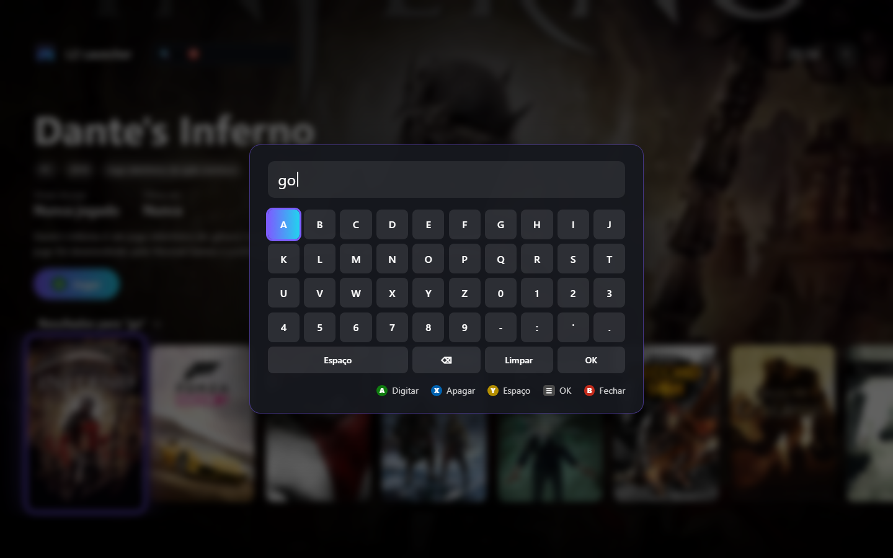
  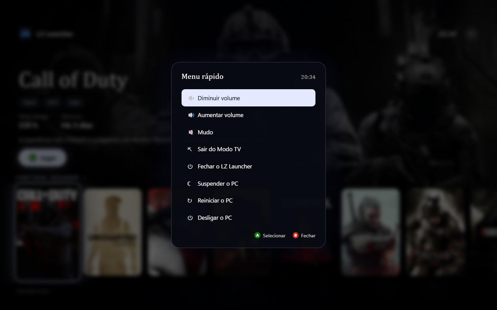

Quando você sai de um jogo aberto pelo Modo TV, o LZ Launcher **volta sozinho para a frente**, já no Modo TV. Abra pelo botão **Modo TV** na barra lateral, pela tecla **F11** ou pelo botão Menu do controle. O controle também navega pela biblioteca normal e, para não atrapalhar, o app só responde a ele quando a janela está em foco.

### Iniciar com o Windows

Em **Configurações → Inicialização**, o LZ Launcher pode abrir junto com o Windows — escondido na bandeja, contando o tempo de jogo, ou **direto no Modo TV**, ideal para um PC ligado na TV.

### Grade ou lista

Alterne entre **grade** de capas (com tamanho ajustável) e **lista** com plataforma, categoria, tempo de jogo e última vez — clique no cabeçalho para ordenar. O app lembra suas escolhas.

### Temas
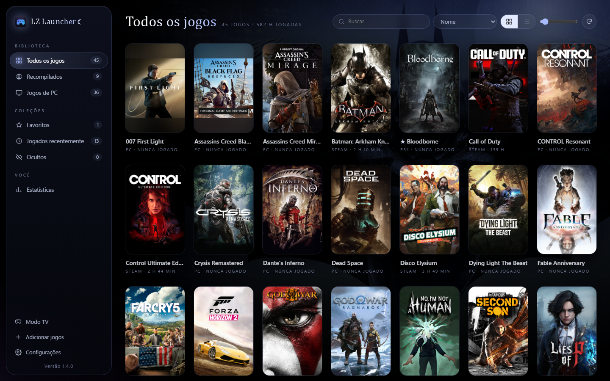

Seis temas em **Configurações → Aparência** — cada um muda bem mais que as cores:

- **Sóbrio** — cinzas neutros, visual de launcher de desktop.
- **Neon** — roxo e ciano, com o destaque *Continue jogando* no topo da biblioteca.
- **Cyberpunk** — amarelo neon, cantos cortados, scanlines, fundo com a arte do jogo em foco e efeitos de glitch.
- **Black Midnight** — preto absoluto, céu estrelado com brilho da lua, barra lateral de vidro flutuante, títulos serifados e reflexo de luar nas capas.
- **Xbox** — inspirado na tela inicial do console: arte do jogo de fundo, blocos com borda verde brilhando no foco e o Modo TV igual ao painel, com perfil, ícones no topo, blocos quadrados e cartões largos (Biblioteca, Conquistas, Buscar e Opções).
- **PS5** — muda o app inteiro: navegação em **abas no topo**, azul profundo com vidro fosco, contorno branco de foco e botão Jogar branco. No Modo TV, a tela inicial do console: abas, fileira de blocos com o jogo em foco maior, ações (Jogar, progresso de conquistas, Favoritar) e cartões de Conquistas, Sobre o jogo, Favoritos, Armazenamento (espaço livre real dos discos), Controle, Mais jogado e Atividade recente.

  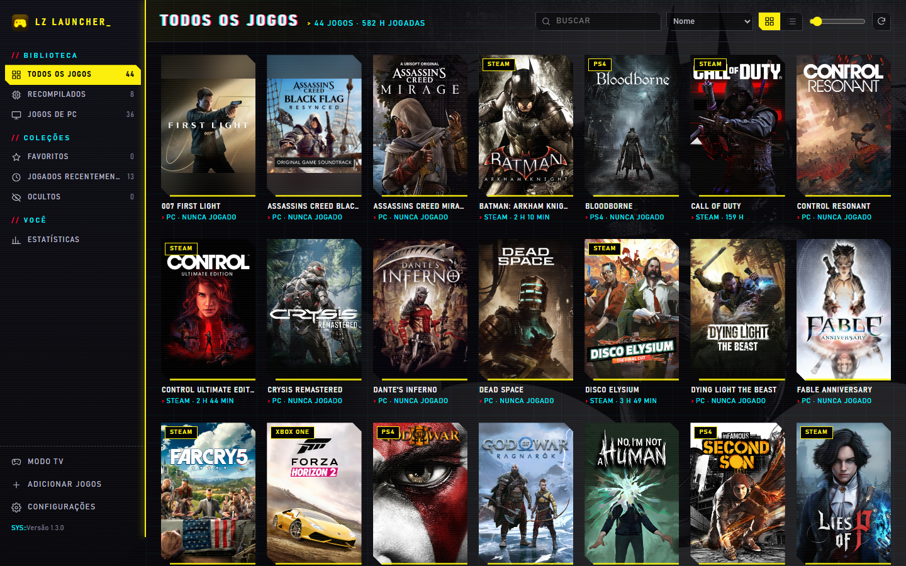
  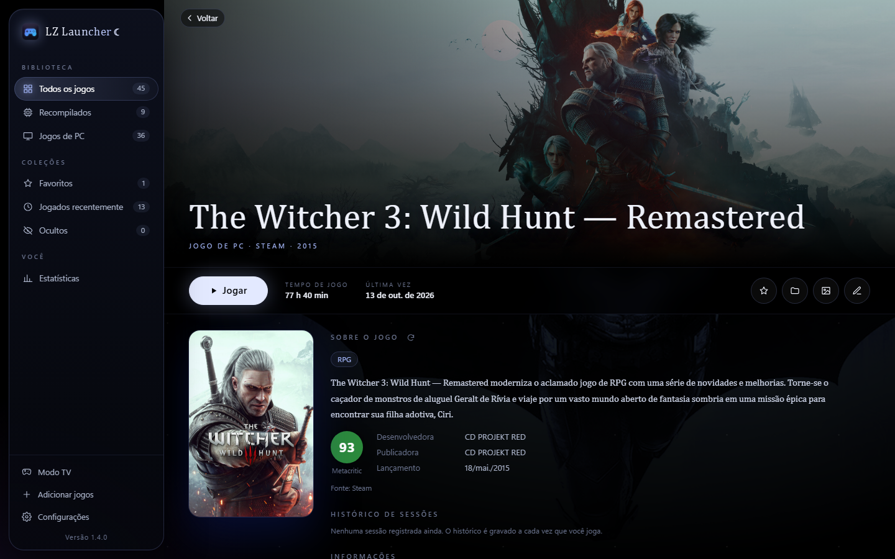

  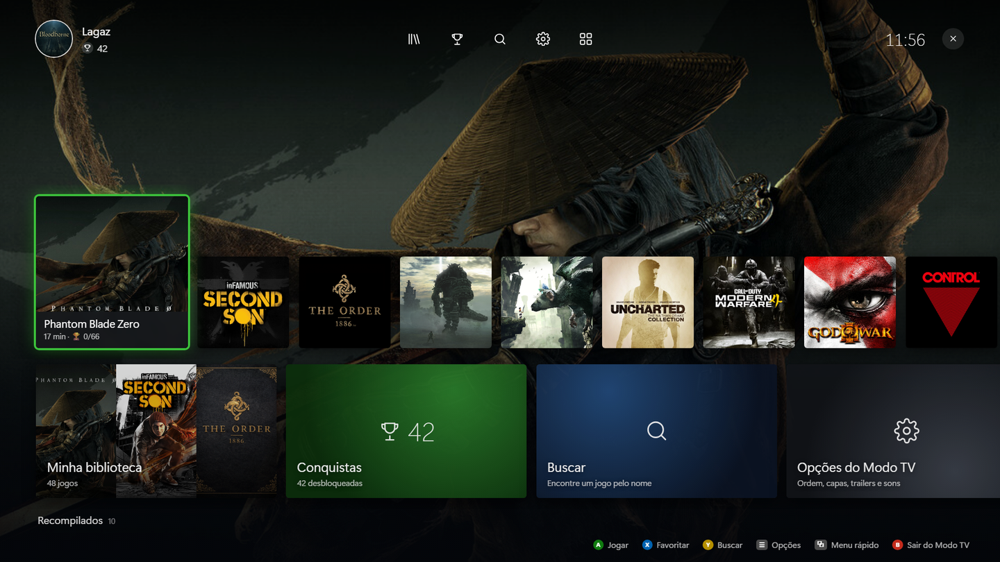
  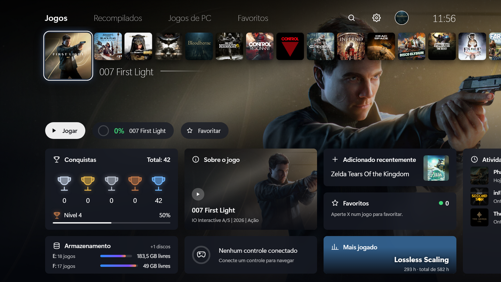

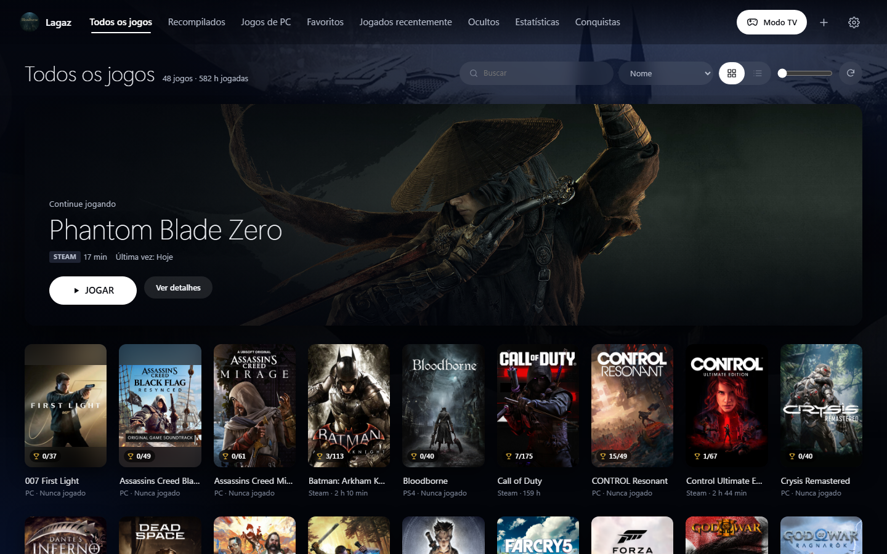

Nos temas Xbox e PS5 cada jogo ganha uma **imagem quadrada** feita para o bloco, sem cortar logo nem arte: a arte oficial quadrada dos ports de PS4 (do próprio jogo), a arte quadrada do [SteamGridDB](https://www.steamgriddb.com) ou, se não houver, a arte oficial com o logo do jogo por cima.

### Perfil
Escolha **seu nome** e uma **foto** em **Configurações → Perfil** (ou clicando no nome na barra lateral). Eles aparecem no lugar de "LZ Launcher" na barra lateral e no Modo TV; o perfil também mostra quantas conquistas você já desbloqueou.

### Bandeja do sistema
Fechar a janela **minimiza o LZ Launcher para a bandeja**, perto do relógio — ele continua contando o tempo de jogo. Clique duas vezes no ícone para voltar ou em **Sair** para fechar de vez. Dá para desligar nas configurações.

## Aviso

O LZ Launcher **não inclui jogos** nem arquivos de jogos: ele só organiza e abre o que já está no seu PC. Os ports recompilados precisam dos seus próprios dumps, conforme as instruções de cada port. O app **nunca altera** nada dentro das pastas dos jogos. Projeto da comunidade, sem relação com Sony, Microsoft, Nintendo, Valve, Epic Games, GOG, Ubisoft, EA ou Blizzard.

## Créditos

- [pywebview](https://github.com/r0x0r/pywebview) — janela do app (WebView2)
- [psutil](https://github.com/giampaolo/psutil) — contagem do tempo de jogo
- [pystray](https://github.com/moses-palmer/pystray) — ícone na bandeja
- [Pillow](https://github.com/python-pillow/Pillow) e [icoextract](https://github.com/jlu5/icoextract) — imagens e ícones dos jogos
- Capas e informações: loja Steam, GOG, [Wikipédia](https://www.wikipedia.org), [Wikidata](https://www.wikidata.org) e [SteamGridDB](https://www.steamgriddb.com)
- Conquistas e troféus: Steam e [Exophase](https://www.exophase.com)
- [PyInstaller](https://pyinstaller.org) e [Inno Setup](https://jrsoftware.org/isinfo.php) — executável e instalador

## Licença

[MIT](LICENSE) © Lagaz
